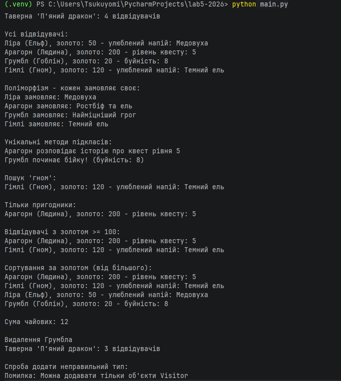

# Звіт до лабораторної роботи №5

## Тема: Основи ООП в Python (Team Project)

## Варіант: `№8: Симулятор фентезі-таверни`

---

### 1. Склад команди

| ПІБ студента | Роль у проєкті | GitHub |
| :----------- | :-------------- | :----- |
| `Довгай Владислав Володимирович`    | `(Developer 1)` | `(https://github.com/vladdovhay)` |

---

### 2. Розподіл завдань

Детально опишіть, хто за яку частину проєкту був відповідальний.

-   **`Довгай Владислав Володимирович`**:
    -   `Розробка абстрактного базового класу Visitor.`
    -   `Реалізація підкласів Customer, Adventurer та Troublemaker.`
    -   `Розробка класу-менеджера Tavern для керування відвідувачами.`
    -   `Реалізація пошуку, фільтрації та сортування відвідувачів.`
    -   `Реалізація поліморфної обробки замовлень і підрахунку чайових.`
    -   `Написання автоматизованих тестів за допомогою unittest.`
    -   `Створення демонстраційного скрипту main.py.`
    -   `Оформлення документації проєкту та робота з Git і GitHub.`

---

### 3. Опис архітектури проєкту

Програма моделює роботу фентезійної таверни, у якій можуть перебувати відвідувачі різних типів. Класи побудовані з використанням абстракції, інкапсуляції, успадкування та поліморфізму.

#### Клас `Visitor`
-   **Призначення:** `абстрактний базовий клас, який визначає спільні властивості та поведінку відвідувачів.`
-   **Атрибути:** `_name - ім'я відвідувача, _race - раса, _gold - кількість золота.`
-   **Методи:** `pay() - оплата замовлення; order() - отримання замовлення; tip() - визначення чайових; __str__() та __repr__() - текстове представлення об'єкта. Методи order() і tip() є абстрактними та реалізуються у підкласах.`

#### Клас `Customer`
-   **Наслідує:** `Visitor`
-   **Призначення:** `представляє звичайного відвідувача таверни.`
-   **Додаткові атрибути/методи:** `_favorite_drink - улюблений напій. order() повертає улюблений напій, а tip() повертає 1 одиницю золота.`

#### Клас `Adventurer`
-   **Наслідує:** `Visitor`
-   **Призначення:** `представляє героя, який шукає пригоди.`
-   **Додаткові атрибути/методи:** `_quest_level - рівень квесту. order() повертає замовлення «Ростбіф та ель», tip() обчислює чайові як подвоєний рівень квесту, tell_story() формує розповідь про пригоду.`

#### Клас `Troublemaker`
-   **Наслідує:** `Visitor`
-   **Призначення:** `представляє проблемного відвідувача, схильного до конфліктів.`
-   **Додаткові атрибути/методи:** `_rowdiness - рівень буйності. order() повертає замовлення «Найміцніший грог», tip() повертає 0, start_fight() формує повідомлення про початок бійки.`

#### Клас `Tavern`
-   **Призначення:** `клас-менеджер, який зберігає та обробляє колекцію відвідувачів.`
-   **Основні методи/атрибути:** `_name - назва таверни, _visitors - список відвідувачів. add_visitor() - додавання відвідувача з перевіркою типу. remove_visitor() - видалення відвідувача. get_all() - отримання списку відвідувачів. search() - пошук за ім'ям або расою. filter_by_type() - фільтрація за типом відвідувача. filter_by_min_gold() - фільтрація за мінімальною кількістю золота. sort_by_gold() та sort_by_name() - сортування відвідувачів. serve_all() - отримання замовлень усіх відвідувачів. total_tips() - підрахунок загальної суми чайових.`

---

### 4. Демонстрація роботи

Для демонстрації роботи програми створено файл main.py, який показує створення таверни та відвідувачів, додавання й видалення об'єктів, пошук, фільтрацію, сортування, поліморфізм і обробку помилок.

Приклад основних операцій:
Створення відвідувачів типів Customer, Adventurer і Troublemaker.
Виведення списку відвідувачів.
Отримання замовлень та обчислення чайових.
Пошук відвідувачів за расою.
Фільтрація за типом і кількістю золота.
Сортування за кількістю золота.
Видалення відвідувача та перевірка помилки при додаванні неправильного типу об'єкта.

`Таверна 'П'яний дракон': 4 відвідувачів

Усі відвідувачі:
Ліра (Ельф), золото: 50 - улюблений напій: Медовуха
Арагорн (Людина), золото: 200 - рівень квесту: 5
Грумбл (Гоблін), золото: 20 - буйність: 8
Гімлі (Гном), золото: 120 - улюблений напій: Темний ель

Поліморфізм - кожен замовляє своє:
Ліра замовляє: Медовуха
Арагорн замовляє: Ростбіф та ель
Грумбл замовляє: Найміцніший грог
Гімлі замовляє: Темний ель

Унікальні методи підкласів:
Арагорн розповідає історію про квест рівня 5
Грумбл починає бійку! (буйність: 8)

Пошук 'гном':
Гімлі (Гном), золото: 120 - улюблений напій: Темний ель

Тільки пригодники:
Арагорн (Людина), золото: 200 - рівень квесту: 5

Відвідувачі з золотом >= 100:
Арагорн (Людина), золото: 200 - рівень квесту: 5
Гімлі (Гном), золото: 120 - улюблений напій: Темний ель

Сортування за золотом (від більшого):
Арагорн (Людина), золото: 200 - рівень квесту: 5
Гімлі (Гном), золото: 120 - улюблений напій: Темний ель
Ліра (Ельф), золото: 50 - улюблений напій: Медовуха
Грумбл (Гоблін), золото: 20 - буйність: 8

Сума чайових: 12

Видалення Грумбла
Таверна 'П'яний дракон': 3 відвідувачів

Спроба додати неправильний тип:
Помилка: Можна додавати тільки об'єкти Visitor`

---

### 5. Висновки

Опишіть, чого ви навчилися під час виконання цієї лабораторної роботи. Які принципи ООП були застосовані? З якими труднощами ви зіткнулися при командній роботі через Git та як їх вирішували?

`Під час виконання лабораторної роботи було закріплено основні принципи об'єктно-орієнтованого програмування. Було створено абстрактний базовий клас і підкласи, які успадковують його властивості та реалізують власну поведінку.`

`Інкапсуляцію застосовано за допомогою захищених атрибутів і властивостей. Успадкування дозволило повторно використовувати спільну логіку класу Visitor, а поліморфізм - обробляти замовлення та чайові різних типів відвідувачів через спільний інтерфейс.`

`Також було реалізовано пошук, фільтрацію, сортування, обробку винятків і автоматизовані тести. Під час роботи з Git і GitHub було використано окремі гілки, коміти та Pull Request для організації змін.`

